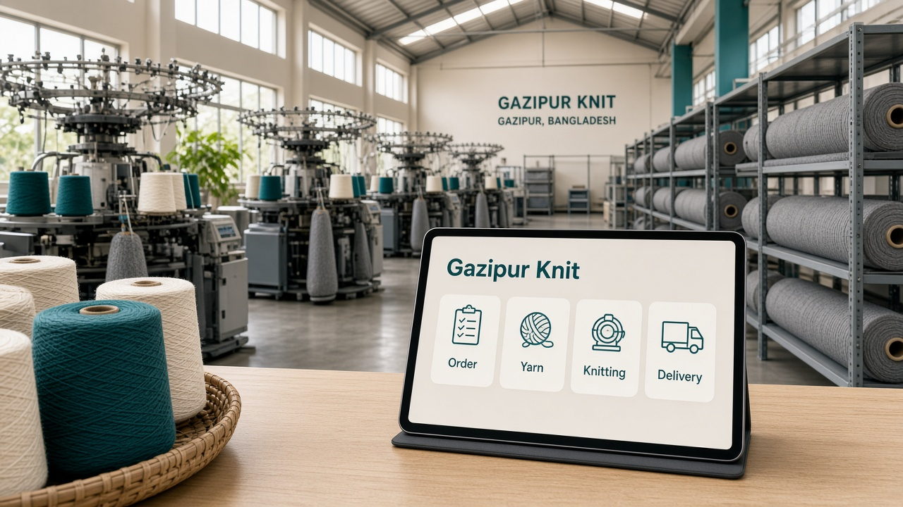
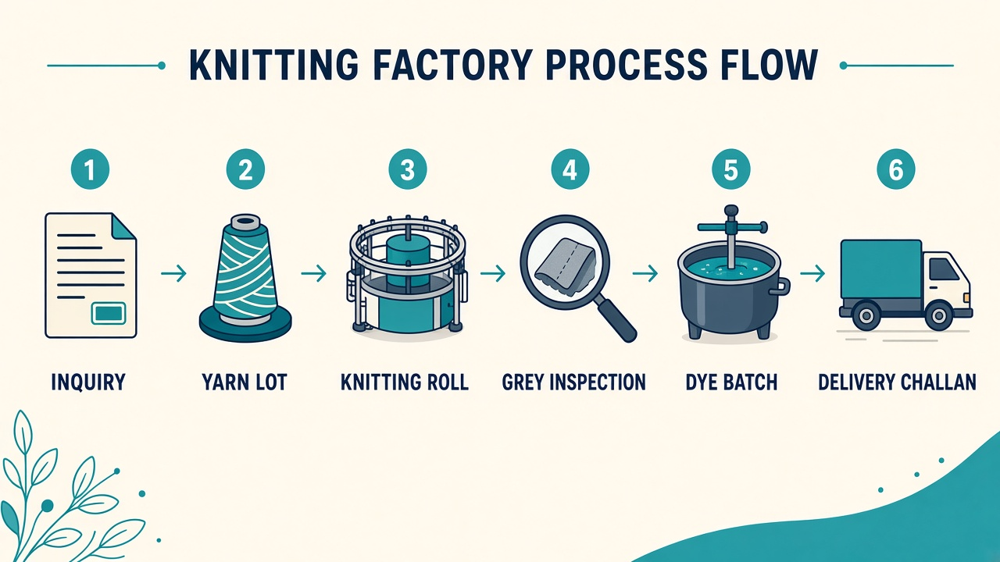
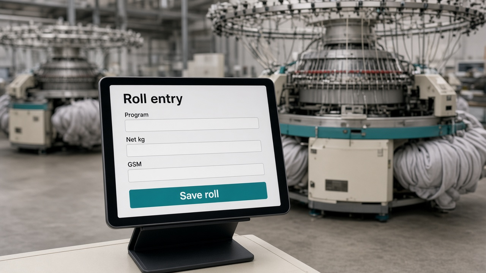
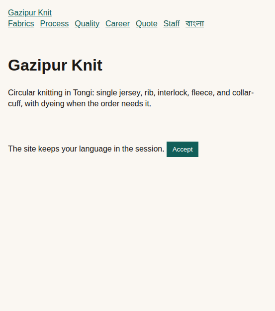

# Gazipur Knit

The register, the Excel file, and the WhatsApp group for a knitting factory, in one place.

A mill in Gazipur, Dhaka, Tiruppur, Karachi, or Ho Chi Minh can run the same book: buyer inquiry, yarn lot, machine program, grey roll, dye batch, finished inspection, challan, and collection. The stock ledger and the accounts stay in step. When a lot is mixed, a machine sits idle, or a delivery slips, the issue board names the owner and the next step.

<p align="center">
  
</p>

Built for composite knit units, standalone knitting factories, knitting-and-dyeing units, and job-work knitters. Bangladesh first, with BDT as the home currency and room for USD and EUR on export orders.

## What the mill gets

- One company, many units: factory floor, yarn godown, grey store, finished store.
- English and Bangla on the public site, with a Bangla calendar available for dates and print.
- Every bag, roll, machine, and gate pass can carry a barcode or QR code.
- Roles for the general manager, production, merchandising, store, quality, accounts, HR, maintenance, and security.
- An issue board that watches the floor and leaves an owner, a deadline, and a suggested fix.
- A public site where a buyer asks for a swatch and the merchandiser already has the inquiry.

## Time the floor gets back

These are the hours a traditional knit unit spends reconstructing paper. The system does that work at the moment of entry.

| Desk | What used to take the evening | What happens at the counter |
|---|---|---|
| Yarn store | Recount bags, argue the challan weight, and hunt a mixed lot after the shade complaint | Receive by lot, weigh against the challan, and block a second lot on the same program unless someone approves the mix |
| Knitting | Copy the shift book into Excel and discover a missing roll at dispatch | Each roll gets the next number, a tag, GSM, weight, machine, and yarn lot while the doff is still on the machine |
| Planning | Phone the floor to ask which machine is free and which order is late | The program sits on a machine that matches type, diameter, and gauge, and the order shows knitting, dyeing, and delivery percent |
| Dye house | Discover the return is short when the bill arrives | Input kilograms, output kilograms, and process loss are on the batch before the bill is passed |
| Merchandising | Answer the buyer from five WhatsApp threads | Order, milestone, and balance are on one screen, and the public quote form opens the inquiry |
| Quality | File the defect in a notebook that never meets the yarn supplier | Grey and finished inspection grade the roll and point the defect back at machine, operator, or lot |
| Accounts | Retype the GRN, the invoice, and the collection into a second set of books | Goods receipt, yarn issue, production, invoice, and collection post balanced journals |
| General manager | Wait for the night summary | Open Issues Today and see what is already late |

A clerk who used to close the yarn book after the shift can leave when the last issue is scanned. The month-end file is the ledger, not a fresh spreadsheet.

## From the buyer’s email to the bank

<p align="center">
  
</p>

1. The buyer asks for a price or a swatch. The website form opens an inquiry for merchandising.
2. Costing turns yarn rate, knitting charge, dyeing charge, process loss, wastage, overhead, finance, and profit into a price per kilogram and per yard.
3. The sales order holds the buyer PO, fabric, colour, GSM, diameter, kilograms, delivery date, tolerance, and whether the yarn is the mill’s or the buyer’s.
4. The bill of materials turns fabric kilograms into yarn kilograms, count by count, including lycra and the allowed loss.
5. Purchase, receipt, and the yarn lot land in the godown. Challan weight and actual weight stay side by side.
6. The knitting program names the machine, stitch length, target GSM, and the lot. Yarn leaves the godown only against that program.
7. The floor tablet records the roll. The roll number does not skip and does not repeat.
8. Grey inspection grades the roll. Dyeing records input, output, and loss. Finished inspection grades again.
9. The packing list, delivery challan, gate pass, and invoice leave together. Collection clears the receivable.

The seeded demo walks that path with one order and leaves the yarn godown, the grey store, and the finished store at zero, with the journals in balance.

<p align="center">
  
</p>

The floor page at `/floor` is built for a tablet. If the network drops, the roll stays on the device until the queue syncs.

## The books

| Area | What you run |
|---|---|
| Company | Units, floors, warehouses, racks, financial year, currencies, exchange rates, VAT and tax rules, units of measure |
| Masters | Buyers, spinners, dyers, banks, transporters, yarn counts and types, fabrics, colours, shade bands, defects, processes, machine brands, employees |
| Merchandising | Inquiry, sample, costing sheet, quotation, price list, sales order, BOM, milestones, amendments |
| Procurement | Requisition, RFQ, comparative quote, purchase order, goods receipt, yarn lot, import file, shipment, supplier bill, debit note |
| Yarn and fabric stock | Append-only ledger by lot, warehouse, and stock type. Issue, return, transfer, cycle count, reorder level |
| Knitting | Machine, program card, shift production, roll, stoppage, needle log, grey inspection, subcontract job |
| Dyeing | Lab dip, recipe, machine, batch, chemical issue, finishing log, shade match |
| Quality | Four-point finished inspection, lab tests, hold and release, corrective action, buyer claim, certificates |
| Delivery | Packing list, challan, invoice, credit note, gate pass, vehicle, trip |
| Waste | Weighed yarn and fabric waste, then a sale through the gate |
| Maintenance | Assets, preventive schedule, breakdown work order, spare parts, electricity, gas, and water readings |
| People | Leave, attendance day, salary structure, payroll run, payslip, loan, incident, PPE, jobs, discipline |
| Accounts | Chart of accounts, journal, voucher, bank, budget, period lock. Order and machine profitability sit on the same books |
| Control | Issue rules, tasks between departments, notification log, webhooks |
| Website | Pages, menus, posts, banners, FAQ, fabric catalog, quote and career forms |

Own-yarn knitting, buyer-supplied job work, yarn sent to another knitter, in-house dyeing, and a feeder path toward cutting all use the same order and the same ledger. A knitting-only mill can leave dyeing off for that company.

## The issue board

Twenty-five watches run from the same list. Each open item has a severity, an owner role, a deadline, and a suggested fix. After the deadline it escalates.

Yarn lot mixed on one program. Yarn issued above the BOM. Yarn that will not cover the program. Machine idle too long. Wrong machine for the fabric. GSM outside the band. The same defect repeating. A duplicate roll. A short dye-house return. A late delivery. A shipment outside tolerance. An overdue buyer. A purchase order, receipt, and bill that do not match. A repeating breakdown. A spare below minimum. Power cost per kilogram too high. Absent without leave. A purchase rate that jumped. Book stock against the physical count. A license about to expire. Waste at the gate with no ledger line. A month still open. Floor data still on paper. A missed buyer milestone. The daily digest for the general manager.

The thresholds live on the Issue Rule screen, so the mill can tighten a limit without a code change.

## The public mill

<p align="center">
  
</p>

The site is server-rendered and edited from the panel: home, fabrics, process, quality, capacity, about, sustainability, clients, gallery, news, downloads, careers, contact, and FAQ. Fabric filters use GSM and composition. A quote or sample request becomes an inquiry. A job application lands in recruitment. Language switches between English and Bangla. Sitemap, robots, and a cookie notice are included.

Staff enter at `/admin`.

## Demo on a fresh database

After seeding, sign in as `admin@gazipurknit.test` with password `password`. Change that password before anyone else can reach the server.

The demo order is a 1,000 kg single jersey, 160 GSM, sold at 650 BDT per kilogram.

| Step | Figure |
|---|---|
| Yarn, with 3% process loss and 2% wastage | 1,050.6 kg |
| Yarn value at 450 BDT per kilogram | 472,770 BDT |
| Grey rolls | 980 kg |
| Finished after dyeing | 950 kg |
| Invoice before VAT | 617,500 BDT |
| VAT at 15% | 92,625 BDT |
| Collected | 710,125 BDT |

Yarn, grey, and finished stock finish at zero. Accounts receivable finishes at zero. Journal debits equal journal credits.

## Run it

Requirements: PHP 8.3 or newer, Composer, and a database. Local development uses SQLite. Production should use MySQL 8 and Redis.

```bash
composer install
cp .env.example .env
php artisan key:generate
touch database/database.sqlite
php artisan migrate
php artisan db:seed
php artisan serve
```

Open the site at the URL Artisan prints. The staff panel is `/admin`. Tests:

```bash
./vendor/bin/pest
```

Seeding loads permissions, the chart of accounts, the issue rules, the public pages, and the demo order. On a slow disk the first seed can take a few minutes because every master row is written to the activity log.

## Stack

Laravel 12, Filament 4, Livewire, Tailwind, Pest. Queues, Redis, Horizon, and Reverb are installed for production. Excel export uses OpenSpout. Activity on every document uses the activity log. API tokens use Sanctum.

Own packages, and where each one fits, are listed in [docs/packages-used.md](docs/packages-used.md). Gaps, including the permission package that is not yet published, are in [docs/package-gaps.md](docs/package-gaps.md).

## More detail

- [Architecture](docs/architecture.md)
- [Modules](docs/modules.md)
- [Permissions](docs/permissions.md)
- [Issue rules](docs/automation-rules.md)
- [HTTP surface](docs/api.md)
- [FastPanel deployment](docs/deployment-fastpanel.md)

## Who should start here

A general manager who wants the night report before the night meeting. A store in-charge who is tired of mixed lots. A merchandiser who is tired of rebuilding the T&A from chat. A knitting manager who wants the idle machine named before the shift ends. An accountant who wants the invoice and the stock to tell the same story.

## Let's connect and collaborate

I am open to senior remote full-stack roles, AI platform architecture contracts, and enterprise technical advisory.

Timezone: UTC+6 (Dhaka / Rangpur, Bangladesh). Flexible overlap with US, UK, and European business hours.

Delivery mode: async-ready, Slack, Discord, Jira, GitHub, and production-first accountability.

| Channel | Address | Action |
|---|---|---|
| Primary portfolio | [imrandev.bd](https://imrandev.bd) | [Visit site](https://imrandev.bd) |
| Packagist packages | [packagist.org/packages/imrandevbd](https://packagist.org/packages/imrandevbd/) | [View packages](https://packagist.org/packages/imrandevbd/) |
| LinkedIn | [linkedin.com/in/imranbru99](https://www.linkedin.com/in/imranbru99) | [Connect](https://www.linkedin.com/in/imranbru99) |
| GitHub | [github.com/imranbru99](https://github.com/imranbru99) | [Follow](https://github.com/imranbru99) |
| WhatsApp | [+880 1576-918420](https://wa.me/8801576918420) | [Chat now](https://wa.me/8801576918420) |
| Email | [me@imrandev.bd](mailto:me@imrandev.bd) | [Send email](mailto:me@imrandev.bd) |
| X | [@imrandev_bd](https://x.com/imrandev_bd) | [Follow](https://x.com/imrandev_bd) |
| YouTube | [@ImranDevBD](https://www.youtube.com/@ImranDevBD) | [Subscribe](https://www.youtube.com/@ImranDevBD) |
